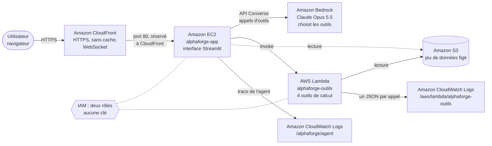

# Calibre : architecture AWS

Calibre est hébergé dans un compte AWS, région `us-east-1`, et repose sur six services. Chacun a un rôle
précis dans le parcours d'une question ; aucun n'est là pour impressionner. **Le modèle de langage
explique, Lambda calcule : aucun chiffre affiché ne vient du modèle.**

## Schéma



## Le parcours d'une question

1. L'utilisateur pose une question dans l'interface, servie en HTTPS par **CloudFront** depuis **EC2**.
2. L'agent envoie la question, le profil et la liste des quatre outils à **Bedrock** (API Converse).
   Le modèle répond par une demande d'outil : `analyser`, `evaluer`, `simuler` ou `proposer_scenarios`.
3. L'outil s'exécute sur **Lambda**, qui lit les prix dans **S3** et renvoie des chiffres.
4. Le modèle rédige l'explication à partir de ces chiffres. Avant affichage, une gouvernance écrite en
   code vérifie chaque nombre cité et l'absence de mots de conseil ; sinon la réponse est régénérée.
5. Chaque étape est journalisée dans **CloudWatch** : demande, outil, contrôles, réponse.

## Chaque service : rôle, justification, alternative écartée

| Service | Rôle dans Calibre | Pourquoi ce choix | Alternative écartée |
|---|---|---|---|
| **Amazon Bedrock** | Fait tourner l'agent (Claude Opus 5.5, profil d'inférence `us.anthropic.claude-opus-5-5`) avec l'API Converse et ses appels d'outils. | Modèle géré, sans serveur à entretenir. Converse nous laisse la boucle d'agent : la gouvernance (vérification des nombres, mots interdits, régénération) reste dans notre code, donc visible et testable. | **Bedrock Agents** : la boucle serait gérée par AWS, nos contrôles seraient plus difficiles à placer entre la réponse et l'affichage. **SageMaker** : héberger un modèle soi-même n'apporte rien ici. |
| **AWS Lambda** | `alphaforge-outils` exécute les quatre outils avec le code des pistes A et B (Python 3.12, couche AWS « AWSSDKPandas » pour pandas et numpy, 1 024 Mo). | Calcul isolé, sans état, payé à l'appel. Le même code tourne en local pour les tests. Chaque appel laisse un JSON dans CloudWatch : les calculs de l'agent sont auditables séparément de l'interface. Mesuré : 4,5 s à froid, 0,1 s ensuite. | **Calculer sur EC2** : plus simple, mais mélange l'interface et les outils de l'agent, et perd le journal par appel. **API Gateway** : inutile, la Lambda n'est appelée que par l'application, avec un rôle IAM. |
| **Amazon S3** | Garde le jeu de données des organisateurs (prix ajustés de 31 actifs, taux USD/CAD) dans `alphaforge-<compte>-donnees`. | Données **figées** : les mêmes entrées redonnent les mêmes résultats. Lambda les lit et les garde en cache dans `/tmp`. | **Rappeler Yahoo Finance en direct** : les cours ajustés changent à chaque téléchargement, les résultats ne seraient plus reproductibles. **Base de données** : aucune écriture, des fichiers suffisent. |
| **Amazon CloudWatch Logs** | `/alphaforge/agent` : la trace de chaque question (outils, contrôles, régénérations, durée). `/aws/lambda/alphaforge-outils` : un JSON par appel d'outil. | La trace est la preuve de l'explicabilité : on relie une conclusion affichée aux outils appelés et à leurs résultats. | Journal local en fichier : perdu au redémarrage, invisible pour l'équipe. |
| **Amazon EC2** | `alphaforge-app` (t3.small, Amazon Linux 2023) fait tourner l'interface Streamlit comme service systemd, relancé automatiquement. Au démarrage, la machine clone le dépôt public et installe `requirements.txt`. | Reçoit ses droits AWS par un **rôle IAM** : aucune clé sur la machine. Une mise à jour = un redémarrage (`python aws/deployer_app.py --mettre-a-jour`). | **Streamlit Community Cloud** (gardé comme lien de secours) : il faudrait y déposer des clés AWS, contraire à nos règles ; sans clés, l'agent n'y répond pas. **App Runner / ECS** : demandent une image de conteneur, plus long pour le même résultat. |
| **Amazon CloudFront** | Sert le site en **HTTPS** (certificat AWS), sans cache, et relaie la WebSocket de Streamlit. | Chiffrement sans acheter de domaine ; adresse stable si la machine redémarre ; la machine n'est plus exposée directement. | Ouvrir le port 80 de la machine au public : HTTP en clair, adresse IP qui change. |

**Repli :** si Lambda est injoignable, l'agent exécute le même code en local et le signale dans ses
limites. Les sections du diagnostic de l'interface calculent en local avec le même code, pour réagir
sans attente aux réglages du profil.

## Sécurité et accès

- **Aucune clé AWS** dans le code, dans Git ou sur les machines. Les droits viennent de deux rôles IAM.
- **Moindre privilège.** `alphaforge-app-role` (EC2) : appeler Bedrock, invoquer la seule fonction
  `alphaforge-outils`, lire le seul seau de données, écrire les traces. `alphaforge-lambda-role` (Lambda) :
  lire le seau de données et écrire ses journaux.
- **Réseau.** Le pare-feu de la machine n'accepte le port 80 que depuis les serveurs de CloudFront
  (liste de préfixes gérée par AWS) ; l'utilisateur ne voit que HTTPS, le HTTP est redirigé.
- **Métadonnées de la machine** en IMDSv2 obligatoire.
- **Aucune donnée personnelle ni bancaire** : portefeuilles fictifs, simulation seulement.

## Ressources et coûts

- Une seule petite machine (t3.small) et une Lambda payée à l'appel ; aucun service allumé pour rien.
- Pas de cache CloudFront : chaque page est dynamique ; CloudFront ne sert qu'au HTTPS et à la protection.
- Coût de la démonstration : quelques centimes de l'heure, plus les appels Bedrock (environ 13 s et
  quelques milliers de jetons par réponse).

## Évolutivité

- **Plus d'utilisateurs** : placer plusieurs machines derrière un équilibreur de charge, ou passer
  l'interface sur App Runner ; Lambda monte en charge seule.
- **Plus d'actifs** : régénérer le jeu de données, le redéposer sur S3 (`python donnees.py televerser`),
  sans toucher au code.
- **Autre modèle** : changer la variable `MODELE_BEDROCK` (par exemple Sonnet pour des réponses plus rapides).

## Reproduire l'installation

```bash
python donnees.py televerser            # crée le seau S3 et dépose les données
python aws/deployer_lambda.py           # crée ou met à jour la Lambda des outils, puis un test de fumée
python aws/deployer_app.py              # crée le rôle, le pare-feu, la machine EC2 et CloudFront
python aws/deployer_app.py --fermer-port     # une fois le HTTPS vérifié : port 80 réservé à CloudFront
```
